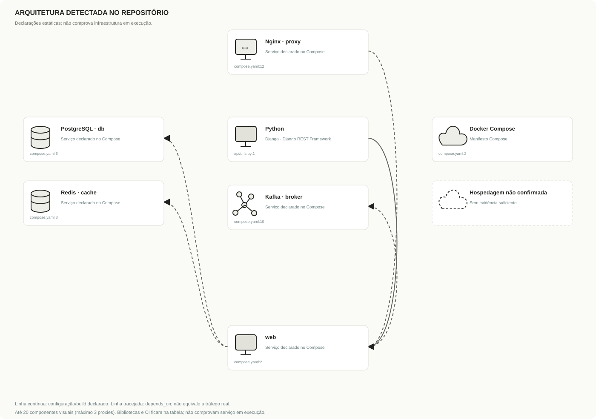

# OctorGit

Understand code. Generate knowledge.

[**Baixar Windows e Linux**](https://github.com/viituux/octorgit/releases/latest) · [Testes automáticos](https://github.com/viituux/octorgit/actions/workflows/tests.yml)

OctorGit lê projetos Python sem importar ou executar código, registra um snapshot de commit do GitHub e produz um inventário verificável. Versão **0.9.0**: mapas visuais, relatório com diagramas, trechos de código, histórico SQLite e comparação por snapshot. IA configurável continua opcional. IR **0.3.0**. A interface foi acrescentada por solicitação do usuário; o gate de qualidade do MVP continua pendente.

## Novo visual — 0.9.0

Interface adaptada das cinco telas do Stitch fornecidas pelo usuário: fundo branco, navegação clara, cores neutras, cartões monocromáticos e tipografia Geist/JetBrains Mono incluída no pacote, sem CDN em runtime.

- Visão geral organiza tecnologias e diagnósticos em colunas com dados da análise, sem métricas fictícias.
- Arquitetura tem canvas de componentes clicáveis e painel adjacente com evidências/código. Zoom, ajuste e exportação SVG continuam disponíveis; imagens exportadas usam o mesmo estilo monocromático.
- Endpoints abrem evidências e código ao lado da tabela.
- Documentação tem índice derivado dos títulos e acesso à preparação do relatório para PDF.
- Administração de IA separa configuração e consumo em abas; conexão GitHub, consentimento privado, histórico e comparação continuam disponíveis.
- Busca global por componentes, endpoints e arquivos da análise, com atalho Ctrl+K (ou ⌘K).

**Exportar PDF** abre as orientações e o relatório completo: use Ctrl+P → Salvar como PDF no navegador. Não há geração direta de um binário PDF. Os dados e indicadores do protótipo do Stitch não são copiados como resultados reais.

## Conexão GitHub e repositórios privados — 0.8.0

Abra **Conexão GitHub**, informe um token de acesso pessoal e clique em **Conectar e verificar conta**. Prefira um token **fine-grained** com os repositórios desejados e permissão **Contents: Read-only** (Metadata: Read-only é incluída pelo GitHub). A lista mostra os repositórios acessíveis ao token, paginados e identificados como públicos ou privados. Escolha **Usar este repositório** e inicie a análise. Organizações podem exigir aprovação do token/SSO, e um token não garante acesso a todos os repositórios da conta.

O token fica apenas na memória do servidor local, nunca em arquivos, histórico, documentos ou pacotes. Reiniciar exige conectar novamente. **Desconectar** remove o token da sessão para novos pedidos; análises já iniciadas podem terminar. Isso não revoga o token no GitHub nem apaga os resultados já salvos. A conexão do ChatGPT não é transferida ao aplicativo. OctorGit não reutiliza automaticamente credenciais do `gh`, `GH_TOKEN` ou `GITHUB_TOKEN`.

Projetos privados também são salvos no histórico local, com trechos filtrados, e podem ser exportados pelo usuário. O envio de fatos privados à IA exige as opções **Usar IA** e **Autorizar IA em repositórios privados**. Sem a segunda autorização, a parte estática é concluída e a IA não é chamada para aquele projeto. Não há OAuth/GitHub App nesta versão; a conexão usa token pessoal informado na tela. A CLI permanece anônima.

## Administração de IA — 0.7.1

No menu **Administração de IA**, configure sua API e acompanhe tokens de entrada/saída, subtotal estimado em USD, orçamento mensal, erros e as 50 chamadas mais recentes. Informe os preços oficiais por milhão de tokens do modelo aplicado e clique em **Salvar gestão de consumo**. Tarifas ficam separadas por provedor/endereço/modelo e são capturadas no início de cada chamada; alterações não recalculam chamadas anteriores.

O orçamento é global para este aplicativo e gera aviso, sem bloqueio automático. **Pausar novas chamadas externas de IA** impede novos pedidos de análise/teste; chamadas em andamento podem terminar, e o cache local continua disponível sem novo consumo. Exporte os 50 registros recentes em CSV para conferência.

O painel registra apenas chamadas feitas pela interface local a partir desta versão, incluindo testes de conexão. Não consulta saldo, fatura, uso de outros aplicativos ou uso da CLI. Totais mensais usam UTC e incluem todos os registros do mês. O histórico local fica em `ai-usage.sqlite3`, ao lado do histórico de análises; nenhuma chave, prompt ou resposta é guardada nesse registro.

Custos desconhecidos são destacados, e o subtotal é parcial nesses casos. Falhas podem ter cobrança mesmo sem tokens informados. Tokens de raciocínio são incluídos na saída quando informados; descontos/cache do provedor, faixas, ferramentas e impostos podem alterar o valor real. **Não é uma fatura nem um limite garantido de gastos.**

## Correções de precisão — 0.6.1

- Endpoints ignoram subpastas `tests`, `test`, `fixtures`, `examples` e `docs`, evitando misturar demonstrações com a aplicação. Os arquivos continuam no inventário; cada exclusão tem diagnóstico. Para analisar uma fixture intencionalmente, selecione sua pasta como raiz da entrada local.
- Compose reconhece `image`, `build` e `depends_on` somente como propriedades diretas do serviço, sem confundir variáveis de ambiente. Aceita diferentes larguras de indentação no subconjunto suportado; não é um interpretador YAML completo.
- SQLite é identificado por chamadas estáticas a `sqlite3.connect`, incluindo aliases e funções locais, com evidência. Um import isolado não confirma uso do banco; variáveis sobrescritas ou parâmetros com o mesmo nome são tratados conservadoramente. Isso não comprova execução da conexão.

## Windows e Linux

O mesmo programa funciona nos dois sistemas, com inicializadores próprios. Requer **Python 3.11+** e navegador; não é um executável independente de Python.

| Sistema | Pacote | Iniciar |
| --- | --- | --- |
| Windows | `octorgit-0.9.0-windows.zip` | Dois cliques em `ABRIR_OCTORGIT.bat` |
| Linux | `octorgit-0.9.0-linux.tar.gz` | `bash ABRIR_OCTORGIT.sh` |

### Linux: início rápido

```bash
bash ABRIR_OCTORGIT.sh
```

Acesse **http://127.0.0.1:8765**. Instruções de instalação, histórico e IA: [LEIA_PRIMEIRO_LINUX.md](LEIA_PRIMEIRO_LINUX.md).

### Prévia visual



O mapa acima é uma fixture demonstrativa, não um screenshot da interface inteira. O aplicativo tem menu lateral claro, canvas interativo, evidências ao lado do código, filtros de endpoints, administração de IA/GitHub e relatório independente. O arquivo `VER_EXEMPLO_VISUAL.html` pode ser aberto diretamente no navegador após baixar o projeto.

## Abrir as telas no Windows

Requisito: Python 3.11 ou superior, com o Python Launcher (`py`). Não precisa instalar Node, Django, banco de dados nem chave de IA.

1. Extraia o ZIP em uma **pasta nova**, sem misturar com a versão anterior.
2. Entre na pasta `octorgit`, onde estão este README e o arquivo `ABRIR_OCTORGIT.bat`.
3. Dê dois cliques em **ABRIR_OCTORGIT.bat**.
4. O navegador abrirá em **http://127.0.0.1:8765**. Mantenha a janela do programa aberta.
5. Clique em **Experimentar um exemplo** para testar sem internet, ou informe a URL de um repositório; para privados, conecte primeiro sua conta.

O inicializador usa diretamente o código da nova pasta: não é necessário instalar novamente o pacote para usá-lo. Ele funciona mesmo com a versão antiga instalada. Não é necessário executar como administrador.

### Pelo PowerShell

Abra o PowerShell dentro da pasta que contém `pyproject.toml`:

```powershell
py -m pip install -e .
py -m octorgit.web
```

Se a porta estiver ocupada:

```powershell
py -m octorgit.web --port 8766
```

Nesse caso abra http://127.0.0.1:8766. Para encerrar, pressione Ctrl+C no terminal. O histórico fica salvo no SQLite local e continua disponível após fechar o programa. Documentos baixados pelo navegador continuam na sua pasta de downloads.

### Telas disponíveis

- **Visão geral:** entrada do repositório, opções de branch/raiz, progresso real por etapa, resumo e lacunas.
- **Endpoints:** busca, filtro de método/confiança, paginação e detalhes das evidências de cada rota.
- **Arquitetura:** linguagem, frameworks, banco e infraestrutura declarados, com ícones, conexões, evidências e download SVG; até 20 componentes no mapa. O mapa de arquivos/imports é separado.
- **Administração de IA:** configurações de API, chave de sessão, consumo, tarifas, orçamento, pausa e histórico de chamadas.
- **Documentação:** leitura de README, endpoints, arquitetura e JSON; download individual ou ZIP.
- **Histórico salvo:** reabertura após reiniciar o aplicativo; até 100 análises recentes na tela, sem apagar automaticamente as antigas do banco.
- **Comparar versões:** mudanças nas rotas/configurações, arquivos e documentos que precisam de revisão.
- **Cobertura:** gráficos de parsing e filtros, campos desconhecidos e diagnósticos por diretório.
- **Relatório visual:** documento HTML independente com seis diagramas SVG e explicações; pode ser salvo como PDF pela impressão do navegador.

Exemplos são identificados como fixtures sem SHA. Para GitHub, referências abrem o arquivo e as linhas no commit analisado. A interface não garante detecção completa de endpoints. Esta é uma interface **local de protótipo**, não uma plataforma hospedada.

## Exportar um documento com os diagramas

Depois de analisar, abra **Relatório visual**. O botão **Relatório visual** no topo baixa `RELATORIO.html`; **Exportar ZIP** inclui o HTML, os documentos e a pasta `diagramas/` com seis SVGs.

1. Baixe o HTML e abra-o em Edge ou Chrome.
2. Pressione **Ctrl+P → Salvar como PDF**.
3. Os diagramas já estão dentro do documento: não precisa de internet, Mermaid ou do OctorGit aberto para visualizar.

O documento contém organização, endpoints/configuração, histórico, comparação, cobertura e trechos de código. Limites de exibição acompanham cada seção; as listas completas permanecem no JSON. Há um exemplo pronto em `examples/relatorio-visual/RELATORIO-EXEMPLO.html` para abrir sem iniciar o aplicativo.

O mapa de tecnologias usa fundo claro e ícones monocromáticos de aplicação, banco, fila e infraestrutura. As conexões representam configurações e dependências declaradas, não tráfego observado. Hospedagem e banco não detectados aparecem como não confirmados. As imagens SVG não dependem de IA.

## Histórico e comparação

No Windows, os dados ficam por padrão em `%LOCALAPPDATA%\OctorGit\history.sqlite3`. A pasta é independente da versão extraída, então novas versões do aplicativo podem usar o mesmo histórico. Para escolher outra pasta:

```powershell
py -m octorgit.web --data-dir .\meu-historico
```

O banco guarda resultados, documentos e trechos filtrados de evidência, não o snapshot completo. Os trechos têm limites de linhas/tamanho. A chave de IA não é salva no histórico. Para limpar todo o histórico, feche o OctorGit e remova o arquivo SQLite da pasta escolhida. A lista mostra as 100 análises mais recentes; registros mais antigos continuam no banco e podem ser recuperados por seu ID.

Para comparar um projeto real, analise duas branches/SHAs do mesmo repositório. Abra a análise mais recente e selecione a base em **Comparar versões**. O relatório/exportação usa essa seleção. Mudança em arquivo de evidência é sinal de revisão, não prova de alteração em cada função; versões diferentes do parser e raízes diferentes geram avisos.

Para testar sem internet, analise **Experimentar um exemplo**; depois abra **Comparar versões → Testar exemplo alterado**. São fixtures autorais sem SHA, identificadas como tal. A segunda muda `/health/` para `/status/` e altera uma permissão declarada.

## Configurar a IA

Abra **Administração de IA**, escolha o tipo de API, informe o modelo, o endereço base e sua chave. Clique em **Aplicar configurações** e, se desejar, **Testar conexão**. Depois marque **Usar IA** ao iniciar uma análise e consulte **Documentação → IA**.

Tipos suportados: APIs compatíveis com OpenAI (`/chat/completions`), Google (`generateContent`) e Anthropic (`/messages`). Uma chave precisa corresponder ao provedor, modelo, permissões e protocolo escolhidos; não existe compatibilidade universal entre chaves. APIs locais compatíveis podem usar HTTP somente em loopback.

A chave recebida pela tela fica apenas na memória do servidor e deve ser informada novamente após reiniciar. Apenas provedor, endereço e modelo são lembrados em `ai-settings.json`. Chaves nunca entram no histórico, relatórios ou pacotes. Veja [CONFIGURAR_IA.md](CONFIGURAR_IA.md) para variáveis de ambiente e CLI.

A IA é opcional e pode consumir cota ou gerar cobrança. Recebe somente fatos selecionados da IR (até 32.000 bytes), sem arquivos brutos ou snippets. Respostas têm limite de 4.096 tokens, 256.000 bytes e timeout de 45 segundos. IDs e estrutura são validados; isso não prova a veracidade semântica das explicações. Falhas preservam a análise estática. Cache em memória considera provedor, endereço, modelo e contexto.

Os três adaptadores foram testados com respostas simuladas; não houve chamada autenticada com uma chave real nesta versão.

## CLI original

```bash
python -m venv .venv
source .venv/bin/activate
# Windows PowerShell: .venv\Scripts\Activate.ps1
python -m pip install -e .
octorgit --local examples/demo --output results/demo
```

Para analisar um repositório público:

```bash
octorgit --repo https://github.com/SEU_USUARIO/SEU_REPOSITORIO --output results/github
# Branch opcional; sem ela, usa a branch padrão retornada pelo GitHub.
octorgit --repo https://github.com/SEU_USUARIO/SEU_REPOSITORIO --branch main --output results/main
```

Use um diretório de saída novo ou vazio, fora da entrada local. O GitHub pode aplicar rate limit a requisições anônimas. Na CLI, o acesso continua anônimo. Na interface local, use Conexão GitHub para acessar repositórios privados.

Sem instalar o pacote, no Linux/macOS:

```bash
PYTHONPATH=src python -m octorgit --local examples/demo --output results/sem-instalacao
PYTHONPATH=src python -m unittest discover -s tests -v
```

## Entregas atuais

- Snapshot público do GitHub resolvido para SHA antes do download; modo local para fixtures sem fingir que há um commit.
- Limites de download, arquivos e volume; filtros de diretórios, links, binários, codificação e padrões de segredos.
- IR JSON versionada com arquivos, hashes, classes, funções, métodos e imports.
- Imports locais absolutos/relativos e reexports simples, sem carregar os módulos.
- `path`, `include` aninhado, namespaces estáticos, listas concatenadas e `urlpatterns +=`.
- Raiz via `ROOT_URLCONF` literal ou `--root-urlconf config.urls`; sem raiz, prefixo não confirmado.
- Métodos em funções decoradas e classes Django View/DRF APIView, incluindo herança local simples.
- SimpleRouter/DefaultRouter, ModelViewSet, ReadOnlyModelViewSet, mixins e ações `@action` comuns.
- Cadeias de evidência de montagem até a view; convenções de routers marcadas como inferidas.
- Benchmark com precisão/recall, erros explícitos e penalização por duplicatas e métodos desconhecidos.
- Validação de referências a arquivos, intervalos de linhas e símbolos extraídos.
- Exportação de `analysis.json`, `README.md`, `ENDPOINTS.md` e `ARCHITECTURE.md`, este com Mermaid.

As exportações estáticas são determinísticas. O documento de IA adicional só é gerado quando a opção de IA é ativada. Métodos só são preenchidos quando há regra suportada. Serializer, permissões e autenticação são exibidos quando há declarações estáticas reconhecidas; getters, expressões e configurações dinâmicas permanecem não confirmados. Routers usam templates `{pk}` para o lookup padrão `[^/.]+`. HEAD/OPTIONS automáticos, API root e sufixos de formato não são enumerados. O mapa de arquivos mostra imports locais resolvidos. O novo mapa de tecnologias identifica extensões, dependências conhecidas e configurações literais de banco, Docker/Compose, Kubernetes, Terraform e Render. Identificar outra linguagem não habilita extração de seus endpoints: o parser de endpoints continua Python/Django/DRF.

## Selecionar raiz e medir resultados

```bash
octorgit --local tests/fixtures/drf_router/repo --root-urlconf config.urls --output results/router
python -m octorgit.benchmark --fixtures tests/fixtures --output results/fixtures.json
python -m octorgit.benchmark --public-manifest docs/benchmarks/rest-framework-tutorial.json --output results/public.json
```

O benchmark recusa sobrescrever um relatório existente. Gabaritos são JSONs revisáveis, escritos por inspeção das declarações, não gerados pelo parser. O teste público baixa apenas o SHA fixado e não executa o projeto. Execute os comandos a partir da raiz do OctorGit após instalar; sem instalar, prefixe com `PYTHONPATH=src` no Linux/macOS.

Verificações desta versão: **110 testes**, **20/20 pares método/rota em três fixtures**, **9/9 endpoints de negócio em um projeto público**, com zero falsos positivos nos escopos dos gabaritos. Isso **não valida o MVP**: as fixtures são sintéticas, o gabarito público é parcial e ainda não foi revisado por uma pessoa independente. Consulte `docs/VERIFICATION.md` e os relatórios em `docs/benchmarks/`.

## Próximas entregas

1. Montar 10 repositórios públicos de validação e gabarito manual de pelo menos 3; seguir `docs/VALIDATION.md`.
2. Ampliar cobertura dinâmica, lookups customizados, métodos automáticos e padrões DRF ainda não suportados; resolver raízes de código em src/backend.
3. Ampliar configuração dinâmica, padrões de serializer/permissão e métodos genéricos de dependências, sempre com evidência.
4. Validar os adaptadores de IA em chamadas reais autorizadas, medir qualidade/custo e aprimorar a relação semântica entre explicações e evidências.
5. Medir precisão, recall, referências, tempo e custo; comparar com duas ferramentas e testar com cinco desenvolvedores.
6. Após o gate de qualidade, evoluir da interface local para uma plataforma hospedada com Django/DRF + Celery/Redis + PostgreSQL e frontend React, se necessário.

Segurança, limitações e arquitetura: `docs/SECURITY.md`, `docs/ARCHITECTURE.md` e `docs/IR_SPEC.md`.
