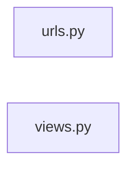

# Inventário de arquitetura

Nós representam arquivos Python aceitos. A organização em camadas ainda não é inferida.

## Imports extraídos

- `urls.py` importa `django.urls.path`. Destino não resolvido. `urls.py:1-1`.
- `urls.py` importa `django.urls.include`. Destino não resolvido. `urls.py:1-1`.
- `urls.py` importa `views.health`. Arquivo local: `views.py`. `urls.py:2-2`.
- `urls.py` importa `views.UserList`. Arquivo local: `views.py`. `urls.py:2-2`.
- `views.py` importa `django.http.JsonResponse`. Destino não resolvido. `views.py:1-1`.
- `views.py` importa `django.views.decorators.http.require_GET`. Destino não resolvido. `views.py:2-2`.
- `views.py` importa `rest_framework.views.APIView`. Destino não resolvido. `views.py:3-3`.
