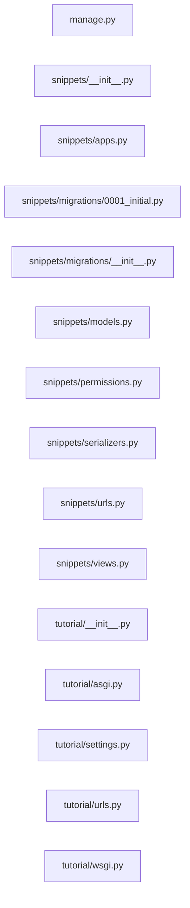

# Inventário de arquitetura

Nós representam arquivos Python aceitos. A organização em camadas ainda não é inferida.

## Imports extraídos

- `manage.py` importa `os`. Destino não resolvido. [manage.py:3-3](https://github.com/encode/rest-framework-tutorial/blob/68c0f79c37bbda4f665711446ee32cbf9f54de7d/manage.py#L3-L3).
- `manage.py` importa `sys`. Destino não resolvido. [manage.py:4-4](https://github.com/encode/rest-framework-tutorial/blob/68c0f79c37bbda4f665711446ee32cbf9f54de7d/manage.py#L4-L4).
- `snippets/apps.py` importa `django.apps.AppConfig`. Destino não resolvido. [snippets/apps.py:1-1](https://github.com/encode/rest-framework-tutorial/blob/68c0f79c37bbda4f665711446ee32cbf9f54de7d/snippets/apps.py#L1-L1).
- `snippets/migrations/0001_initial.py` importa `django.conf.settings`. Destino não resolvido. [snippets/migrations/0001_initial.py:1-1](https://github.com/encode/rest-framework-tutorial/blob/68c0f79c37bbda4f665711446ee32cbf9f54de7d/snippets/migrations/0001_initial.py#L1-L1).
- `snippets/migrations/0001_initial.py` importa `django.db.migrations`. Destino não resolvido. [snippets/migrations/0001_initial.py:2-2](https://github.com/encode/rest-framework-tutorial/blob/68c0f79c37bbda4f665711446ee32cbf9f54de7d/snippets/migrations/0001_initial.py#L2-L2).
- `snippets/migrations/0001_initial.py` importa `django.db.models`. Destino não resolvido. [snippets/migrations/0001_initial.py:2-2](https://github.com/encode/rest-framework-tutorial/blob/68c0f79c37bbda4f665711446ee32cbf9f54de7d/snippets/migrations/0001_initial.py#L2-L2).
- `snippets/migrations/0001_initial.py` importa `django.db.models.deletion`. Destino não resolvido. [snippets/migrations/0001_initial.py:3-3](https://github.com/encode/rest-framework-tutorial/blob/68c0f79c37bbda4f665711446ee32cbf9f54de7d/snippets/migrations/0001_initial.py#L3-L3).
- `snippets/models.py` importa `django.db.models`. Destino não resolvido. [snippets/models.py:1-1](https://github.com/encode/rest-framework-tutorial/blob/68c0f79c37bbda4f665711446ee32cbf9f54de7d/snippets/models.py#L1-L1).
- `snippets/models.py` importa `pygments.highlight`. Destino não resolvido. [snippets/models.py:2-2](https://github.com/encode/rest-framework-tutorial/blob/68c0f79c37bbda4f665711446ee32cbf9f54de7d/snippets/models.py#L2-L2).
- `snippets/models.py` importa `pygments.formatters.html.HtmlFormatter`. Destino não resolvido. [snippets/models.py:3-3](https://github.com/encode/rest-framework-tutorial/blob/68c0f79c37bbda4f665711446ee32cbf9f54de7d/snippets/models.py#L3-L3).
- `snippets/models.py` importa `pygments.lexers.get_all_lexers`. Destino não resolvido. [snippets/models.py:4-4](https://github.com/encode/rest-framework-tutorial/blob/68c0f79c37bbda4f665711446ee32cbf9f54de7d/snippets/models.py#L4-L4).
- `snippets/models.py` importa `pygments.lexers.get_lexer_by_name`. Destino não resolvido. [snippets/models.py:4-4](https://github.com/encode/rest-framework-tutorial/blob/68c0f79c37bbda4f665711446ee32cbf9f54de7d/snippets/models.py#L4-L4).
- `snippets/models.py` importa `pygments.styles.get_all_styles`. Destino não resolvido. [snippets/models.py:5-5](https://github.com/encode/rest-framework-tutorial/blob/68c0f79c37bbda4f665711446ee32cbf9f54de7d/snippets/models.py#L5-L5).
- `snippets/permissions.py` importa `rest_framework.permissions`. Destino não resolvido. [snippets/permissions.py:1-1](https://github.com/encode/rest-framework-tutorial/blob/68c0f79c37bbda4f665711446ee32cbf9f54de7d/snippets/permissions.py#L1-L1).
- `snippets/serializers.py` importa `django.contrib.auth.models.User`. Destino não resolvido. [snippets/serializers.py:1-1](https://github.com/encode/rest-framework-tutorial/blob/68c0f79c37bbda4f665711446ee32cbf9f54de7d/snippets/serializers.py#L1-L1).
- `snippets/serializers.py` importa `rest_framework.serializers`. Destino não resolvido. [snippets/serializers.py:2-2](https://github.com/encode/rest-framework-tutorial/blob/68c0f79c37bbda4f665711446ee32cbf9f54de7d/snippets/serializers.py#L2-L2).
- `snippets/serializers.py` importa `snippets.models.Snippet`. Arquivo local: `snippets/models.py`. [snippets/serializers.py:4-4](https://github.com/encode/rest-framework-tutorial/blob/68c0f79c37bbda4f665711446ee32cbf9f54de7d/snippets/serializers.py#L4-L4).
- `snippets/urls.py` importa `django.urls.include`. Destino não resolvido. [snippets/urls.py:1-1](https://github.com/encode/rest-framework-tutorial/blob/68c0f79c37bbda4f665711446ee32cbf9f54de7d/snippets/urls.py#L1-L1).
- `snippets/urls.py` importa `django.urls.path`. Destino não resolvido. [snippets/urls.py:1-1](https://github.com/encode/rest-framework-tutorial/blob/68c0f79c37bbda4f665711446ee32cbf9f54de7d/snippets/urls.py#L1-L1).
- `snippets/urls.py` importa `rest_framework.routers.DefaultRouter`. Destino não resolvido. [snippets/urls.py:2-2](https://github.com/encode/rest-framework-tutorial/blob/68c0f79c37bbda4f665711446ee32cbf9f54de7d/snippets/urls.py#L2-L2).
- `snippets/urls.py` importa `snippets.views`. Arquivo local: `snippets/views.py`. [snippets/urls.py:4-4](https://github.com/encode/rest-framework-tutorial/blob/68c0f79c37bbda4f665711446ee32cbf9f54de7d/snippets/urls.py#L4-L4).
- `snippets/views.py` importa `django.contrib.auth.models.User`. Destino não resolvido. [snippets/views.py:1-1](https://github.com/encode/rest-framework-tutorial/blob/68c0f79c37bbda4f665711446ee32cbf9f54de7d/snippets/views.py#L1-L1).
- `snippets/views.py` importa `rest_framework.permissions`. Destino não resolvido. [snippets/views.py:2-2](https://github.com/encode/rest-framework-tutorial/blob/68c0f79c37bbda4f665711446ee32cbf9f54de7d/snippets/views.py#L2-L2).
- `snippets/views.py` importa `rest_framework.renderers`. Destino não resolvido. [snippets/views.py:2-2](https://github.com/encode/rest-framework-tutorial/blob/68c0f79c37bbda4f665711446ee32cbf9f54de7d/snippets/views.py#L2-L2).
- `snippets/views.py` importa `rest_framework.viewsets`. Destino não resolvido. [snippets/views.py:2-2](https://github.com/encode/rest-framework-tutorial/blob/68c0f79c37bbda4f665711446ee32cbf9f54de7d/snippets/views.py#L2-L2).
- `snippets/views.py` importa `rest_framework.decorators.action`. Destino não resolvido. [snippets/views.py:3-3](https://github.com/encode/rest-framework-tutorial/blob/68c0f79c37bbda4f665711446ee32cbf9f54de7d/snippets/views.py#L3-L3).
- `snippets/views.py` importa `rest_framework.response.Response`. Destino não resolvido. [snippets/views.py:4-4](https://github.com/encode/rest-framework-tutorial/blob/68c0f79c37bbda4f665711446ee32cbf9f54de7d/snippets/views.py#L4-L4).
- `snippets/views.py` importa `snippets.models.Snippet`. Arquivo local: `snippets/models.py`. [snippets/views.py:6-6](https://github.com/encode/rest-framework-tutorial/blob/68c0f79c37bbda4f665711446ee32cbf9f54de7d/snippets/views.py#L6-L6).
- `snippets/views.py` importa `snippets.permissions.IsOwnerOrReadOnly`. Arquivo local: `snippets/permissions.py`. [snippets/views.py:7-7](https://github.com/encode/rest-framework-tutorial/blob/68c0f79c37bbda4f665711446ee32cbf9f54de7d/snippets/views.py#L7-L7).
- `snippets/views.py` importa `snippets.serializers.SnippetSerializer`. Arquivo local: `snippets/serializers.py`. [snippets/views.py:8-8](https://github.com/encode/rest-framework-tutorial/blob/68c0f79c37bbda4f665711446ee32cbf9f54de7d/snippets/views.py#L8-L8).
- `snippets/views.py` importa `snippets.serializers.UserSerializer`. Arquivo local: `snippets/serializers.py`. [snippets/views.py:8-8](https://github.com/encode/rest-framework-tutorial/blob/68c0f79c37bbda4f665711446ee32cbf9f54de7d/snippets/views.py#L8-L8).
- `tutorial/asgi.py` importa `os`. Destino não resolvido. [tutorial/asgi.py:10-10](https://github.com/encode/rest-framework-tutorial/blob/68c0f79c37bbda4f665711446ee32cbf9f54de7d/tutorial/asgi.py#L10-L10).
- `tutorial/asgi.py` importa `django.core.asgi.get_asgi_application`. Destino não resolvido. [tutorial/asgi.py:12-12](https://github.com/encode/rest-framework-tutorial/blob/68c0f79c37bbda4f665711446ee32cbf9f54de7d/tutorial/asgi.py#L12-L12).
- `tutorial/settings.py` importa `os`. Destino não resolvido. [tutorial/settings.py:11-11](https://github.com/encode/rest-framework-tutorial/blob/68c0f79c37bbda4f665711446ee32cbf9f54de7d/tutorial/settings.py#L11-L11).
- `tutorial/settings.py` importa `dj_database_url`. Destino não resolvido. [tutorial/settings.py:12-12](https://github.com/encode/rest-framework-tutorial/blob/68c0f79c37bbda4f665711446ee32cbf9f54de7d/tutorial/settings.py#L12-L12).
- `tutorial/urls.py` importa `django.urls.include`. Destino não resolvido. [tutorial/urls.py:1-1](https://github.com/encode/rest-framework-tutorial/blob/68c0f79c37bbda4f665711446ee32cbf9f54de7d/tutorial/urls.py#L1-L1).
- `tutorial/urls.py` importa `django.urls.path`. Destino não resolvido. [tutorial/urls.py:1-1](https://github.com/encode/rest-framework-tutorial/blob/68c0f79c37bbda4f665711446ee32cbf9f54de7d/tutorial/urls.py#L1-L1).
- `tutorial/urls.py` importa `drf_spectacular.views.SpectacularAPIView`. Destino não resolvido. [tutorial/urls.py:2-2](https://github.com/encode/rest-framework-tutorial/blob/68c0f79c37bbda4f665711446ee32cbf9f54de7d/tutorial/urls.py#L2-L2).
- `tutorial/urls.py` importa `drf_spectacular.views.SpectacularSwaggerView`. Destino não resolvido. [tutorial/urls.py:2-2](https://github.com/encode/rest-framework-tutorial/blob/68c0f79c37bbda4f665711446ee32cbf9f54de7d/tutorial/urls.py#L2-L2).
- `tutorial/wsgi.py` importa `os`. Destino não resolvido. [tutorial/wsgi.py:10-10](https://github.com/encode/rest-framework-tutorial/blob/68c0f79c37bbda4f665711446ee32cbf9f54de7d/tutorial/wsgi.py#L10-L10).
- `tutorial/wsgi.py` importa `django.core.wsgi.get_wsgi_application`. Destino não resolvido. [tutorial/wsgi.py:12-12](https://github.com/encode/rest-framework-tutorial/blob/68c0f79c37bbda4f665711446ee32cbf9f54de7d/tutorial/wsgi.py#L12-L12).
